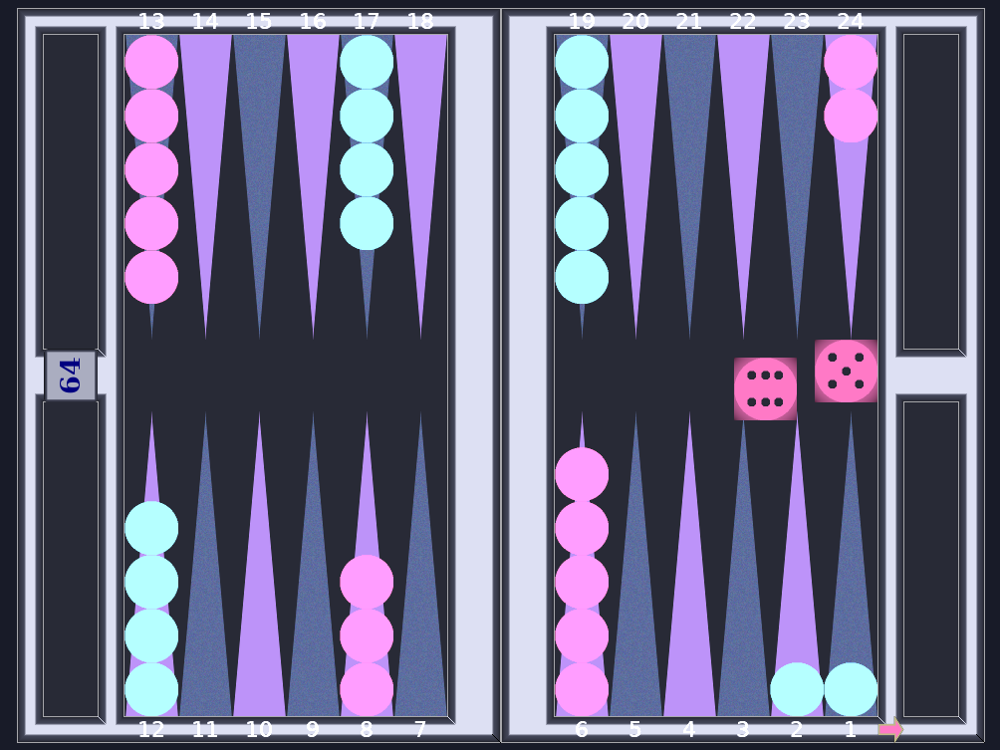

# 🧛 Dracula Theme for GNU Backgammon

A dark, modern, and vibrant color scheme for **GNU Backgammon (gnubg)** inspired by the famous [Dracula Theme](https://draculatheme.com). Give your backgammon matches a sleek, eye-catching, and dark-mode friendly look!

---

## ✨ Features

* 🪵 **Custom Board Layout:** Reimagined board colors utilizing the iconic Dracula palette.
* 🧛 **Dracula Colors:** Features the classic dark background, crisp purples, and vibrant accents.
* 👁️ **Eye-Care Friendly:** Designed for long analysis sessions without straining your eyes.
* 🚀 **1-Click Import:** Ready-to-use XML configuration file for instant setup.

---

## 📸 Preview & Palette

| Board Component | Dracula Palette Color |
| :--- | :--- |
| **Background / Border** | Dracula Background (`#282a36`) |
| **Chequer 1 (Dark)** | Dracula Purple (`#bd93f9`) |
| **Chequer 2 (Light)** | Dracula Pink (`#ff79c6`) |
| **Points (Even/Odd)** | Dracula Cyan (`#8be9fd`) & Dracula Comment (`#6272a4`) |

---

## 🚀 Installation & Setup

Applying the theme is incredibly easy thanks to the XML export:

1. **Download** the `dracula-theme.xml` file from this repository.
2. **Open** GNU Backgammon.
3. Go to the top menu and select **Settings** ➡️ **Appearance** ➡️ **Designs**.
4. Click on **Import** and select the downloaded `dracula-theme.xml` file.
5. Click **Save Settings** so the theme applies automatically on every startup! 💾

---

## 🤝 Contributing

Contributions, issues, and feature requests are welcome! Feel free to check the [issues page](https://github.com).

## 📝 License

This project is [GNU GPLv3](LICENSE) licensed.

---

Made with 💜 for the Backgammon Community.

